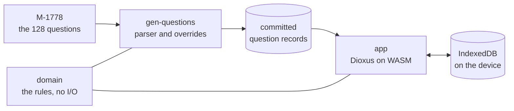

# USCIS-N400


A single-user, phone-first study tool for the civics portion of the U.S.
naturalization interview. It drills the 2025 civics test questions and simulates
the test itself, entirely in the browser: no server, no account.

## Contents

- [What it is](#what-it-is)
- [Features](#features)
- [Tech stack](#tech-stack)
- [Architecture](#architecture)
- [Project structure](#project-structure)
- [Status and roadmap](#status-and-roadmap)
- [Getting started](#getting-started)
- [Contributing](#contributing)
- [License](#license)
- [Acknowledgements](#acknowledgements)

## What it is

The real civics test is oral and governed by specific rules: a standard
applicant answers up to 20 of the 128 official questions and passes with 12,
while an applicant eligible for the 65/20 Special Consideration studies only the
20 starred questions, answers 10, and passes with 6. The officer stops as soon as
the outcome is decided, and accepts alternative phrasings of a correct answer.
Paper lists and flashcard apps do not model any of that, cannot accept a phrasing
the answer key omits, and do not leave the Applicant's progress under their own
control.

This tool models those rules exactly. It drills the 128 Civics Test Questions
with typed answers judged against the official Accepted Answers, tracks Cleared
and Coverage, simulates either administration of the Exam, and works offline from
a phone's home screen. An Override corrects a single verdict without ever
changing the official answers. All progress lives in the browser's storage on the
device, with JSON export and import as the backup.

The screens:

| Screen | Purpose |
|---|---|
| Onboarding | First run only. Establishes the Profile and the Coverage denominator. |
| Main menu | Entry point. Shows Coverage. |
| Study | The endless question loop. No statistics. |
| Exam | One Exam, ending when the outcome is decided. |
| Exam result | That Exam's outcome and score. |
| Stats | Coverage per Section and Topic, and Exam history. |
| Profile | The onboarding fields, editable, plus export and import. |

## Features

- The 128 official 2025 Civics Test Questions with their Accepted Answers,
  generated from USCIS publication M-1778 and corrected by hand.
- Typed answers, judged by normalized exact matching, including parenthetical
  variants and multi-item counting for questions like "Name two".
- Cleared state (three correct in a row) and Coverage as a percentage and a
  count, globally and per Section and Topic.
- Weighted question selection: least-asked, wrong-answer, and Section balance,
  with a recent-ask penalty and no immediate repeats.
- The 65/20 Special Consideration: study narrows to the 20 starred questions,
  and the Exam switches to the 10-question, 6-to-pass administration.
- Exam simulation that stops the moment the outcome is fixed, exactly as the
  officer stops the real test.
- Override: correct a single verdict; the official answers never change.
- Offline-first PWA, installable to the home screen; progress stays on the
  device.
- JSON export and import of all progress, the only backup and the only way to
  move between devices.
- No server, no account, no telemetry.

## Tech stack

- Rust (Edition 2024), in a three-crate workspace.
- Dioxus 0.7 compiled to WebAssembly, web target only.
- IndexedDB for persistence, behind a single storage module.
- Plain CSS, no framework.
- Static hosting on GitHub Pages; there is no backend anywhere.

## Architecture

`domain` holds the model and the rules with no I/O, so it tests natively;
`gen-questions` turns the USCIS question list into the committed records;
`app` is the Dioxus application. Dependencies point one way, and nothing depends
on the generator, so its PDF tooling can never reach the shipped bundle.



Decisions and rejected alternatives are recorded as ADRs in `docs/adr/`; the
domain vocabulary and every behavioral rule live in `GLOSSARY.md`.

## Project structure

```
.
├── domain/             # the model and rules, no I/O
├── gen-questions/      # M-1778 parser, overrides, the committed records
├── app/                # the Dioxus application
├── data/               # committed question records, generated, never hand-edited
├── docs/               # ADRs, coding standards, library docs, research notes, sources
├── scripts/ .githooks/ # the pre-commit quality gates and their installer
├── AGENTS.md           # agent entry: skills config, docs map, standing rules
└── .agents/ .claude/   # agent skills, pinned in-repo so machines stay identical
```

The three crates and the gate scripts arrive with the scaffold, ticket #2; the
rest is in place today.

## Status and roadmap

**Design complete. No code yet.** The language, rules, and decisions are settled
in `GLOSSARY.md` and `docs/adr/`; `docs/open-work.md` lists what is decided but
unbuilt; nothing is open.

The v1 build is issue #1 on the
[tracker](https://github.com/barduinor/USCIS-N400/issues), sliced into tickets #2
through #15, each labelled `ready-for-agent`. In order: workspace and gates, the
question records, the domain model, the app shell, storage and onboarding, the
study loop, selection, progress, the reveal and Override, the Exam, Stats,
profile with export and import, the offline PWA, and CI deploy.

## Getting started

Everything a fresh machine needs, in order:

1. **Clone the repository.** Its agent skills are pinned inside it
   (`.agents/skills/`, `.claude/skills/`, `skills-lock.json`), so there is
   nothing to install globally: an agent harness that scans repo-local skill
   directories picks them up on its own.
2. **GitHub CLI, authenticated.** Agents read and write the issue tracker with
   `gh`. Run `gh auth login` once per machine; verify with `gh auth status`.
3. **Rust toolchain** (needed from the scaffold onward). Install `rustup`, then
   add the wasm target: `rustup target add wasm32-unknown-unknown`. The exact
   toolchain gets pinned by `rust-toolchain.toml` when the scaffold lands.
4. **Dioxus CLI** (needed to serve and build the app, from the app-shell ticket
   onward): `cargo install dioxus-cli --locked`, or a prebuilt binary.
5. **Hooks, once the scaffold lands.** `scripts/install-hooks` points git at
   the pre-commit hook, so every commit runs the four quality gates locally.
6. **Optional: Node**, used only to update the pinned skills.

That is the whole list: git, an agent harness, `gh`, and the Rust toolchain.
There are no servers, databases, or credentials to arrange; the only account
involved is GitHub.

Once the scaffold lands, the everyday commands are `cargo test` for the whole
workspace suite, `cargo run -p gen-questions` to regenerate the committed
records, and `dx serve` from the app crate to run the application.

## Contributing

This is a personal, single-user project, worked through its own issue tracker.
The v1 spec is issue #1, and every build ticket carries its own acceptance
criteria.

- Ticket work lands on a branch per ticket, merged to `main` when the quality
  gates are green.
- The four gates and the pre-commit hook are documented in
  `docs/coding-standards/rust/rust-best-practices/quality-gates.md`.
- Bugs and ideas go to the tracker; the triage labels sort them.
- Conventions for agents live in `AGENTS.md` and `docs/agents/`.

## License

MIT. See [LICENSE](LICENSE).

## Acknowledgements

The question list, Accepted Answers, and scoring rules come from USCIS
publications, kept in `docs/resources/`; current officeholder values come from
the USCIS test-updates page. Built with Rust and Dioxus.
