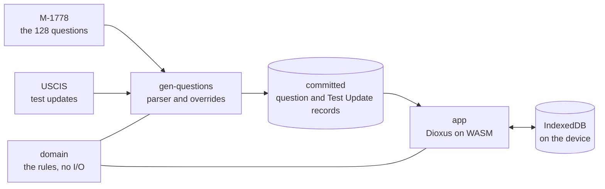

# USCIS-N400


A single-user, phone-first study tool for the civics portion of the U.S.
naturalization interview. It drills the 2025 civics test questions and simulates
the test itself, entirely in the browser: no server, no account.

## Contents

- [What it is](#what-it-is)
- [Features](#features)
- [Tech stack](#tech-stack)
- [Architecture](#architecture)
- [Project structure](#project-structure)
- [Documentation](#documentation)
- [Status and roadmap](#status-and-roadmap)
- [Getting started](#getting-started)
- [Contributing](#contributing)
- [License](#license)
- [Acknowledgements](#acknowledgements)

## What it is

The real civics test is oral and governed by specific rules: a standard
applicant answers up to 20 of the 128 official questions and passes with 12,
while an applicant eligible for the 65/20 Special Consideration studies only the
20 starred questions, answers 10, and passes with 6. The officer stops as soon as
the outcome is decided, and accepts alternative phrasings of a correct answer.
Paper lists and flashcard apps do not model any of that, cannot accept a phrasing
the answer key omits, and do not leave the Applicant's progress under their own
control.

This tool models those rules exactly. It drills the 128 Civics Test Questions
with typed answers judged against the official Accepted Answers, tracks Cleared
and Coverage, simulates either administration of the Exam, and works offline from
a phone's home screen. An Override corrects a single verdict without ever
changing the official answers. All progress lives in the browser's storage on the
device, with JSON export and import as the backup.

The screens:

| Screen | Purpose |
|---|---|
| Onboarding | First run only. Establishes the Profile and the Coverage denominator. |
| Main menu | Entry point. Shows Coverage. |
| Study | The endless question loop. No statistics. |
| Exam | One Exam, with its current progress and per-answer feedback, ending when the outcome is decided. |
| Exam result | That Exam's outcome and score. |
| Stats | Coverage per Section and Topic, and Exam history. |
| Profile | The onboarding fields, editable, plus export, import, the two clears, and reset. |

## Features

- The 128 official 2025 Civics Test Questions with their Accepted Answers,
  generated from USCIS publication M-1778 and corrected by hand.
- Typed answers, judged by normalized exact matching: the key's parenthetical
  variants, a numeral's digit form (`27` for `Twenty-seven (27)`), a joining of
  two of the key's answers, and multi-item counting for questions like
  "Name two".
- Cleared state (one correct answer, or three in a row after a wrong one) and
  Coverage as a percentage and a count, globally and per Section and Topic.
- The four national Test Update values prefilled from the USCIS page, as fresh
  as the release, and editable where an election has moved on.
- Weighted question selection: least-asked, wrong-answer, and Section balance,
  with a recent-ask penalty and no immediate repeats.
- The 65/20 Special Consideration: study narrows to the 20 starred questions,
  and the Exam switches to the 10-question, 6-to-pass administration.
- Exam simulation that shows the current Exam's official question number,
  position, asked sequence, and right/wrong counts, gives the verdict after
  each answer, and stops the moment the outcome is fixed, exactly as the
  officer stops the real test.
- Override: correct a single verdict; the official answers never change.
- Offline-first PWA, installable to the home screen; progress stays on the
  device.
- JSON export and import of all progress, the only backup and the only way to
  move between devices; an import onto a device with history asks whether to
  keep, replace, or merge.
- Clear study answers or the Exam history separately from the Profile screen,
  each behind its own confirmation; the Profile and the other history stay.
- Reset from the Profile screen: a confirmation that names everything it
  deletes, offers the export beside it, and returns the app to onboarding with
  the worker and its cache in place.
- The four national Test Update values ship as generated data from the USCIS
  test-updates page, filled in when a Profile field is blank; a value the
  Applicant typed always wins.
- No server, no account, no telemetry.

## Tech stack

- Rust (Edition 2024), in a three-crate workspace.
- Dioxus 0.7 compiled to WebAssembly, web target only.
- IndexedDB for persistence, behind a single storage module.
- Plain CSS, no framework.
- Static hosting on GitHub Pages; there is no backend anywhere.

## Architecture

`domain` holds the model and the rules with no I/O, so it tests natively;
`gen-questions` turns the USCIS question list and the test-updates page into the
committed records; `app` is the Dioxus application. Dependencies point one way,
and nothing depends on the generator, so its PDF and HTTP tooling can never
reach the shipped bundle.



Decisions and rejected alternatives are recorded as ADRs in `docs/adr/`; the
domain vocabulary and every behavioral rule live in `GLOSSARY.md`.

## Project structure

```
.
├── crates/             # the Rust workspace
│   ├── domain/         #   the model and rules, no I/O
│   ├── gen-questions/  #   the M-1778 pipeline and its overrides
│   └── app/            #   the Dioxus application
│       └── data/       #   committed question and Test Update records, generated, never hand-edited
├── docs/               # ADRs, coding standards, library docs, research notes, sources
├── scripts/ .githooks/ # the pre-commit quality gates and their installer
├── AGENTS.md           # agent entry: skills config, docs map, standing rules
└── .agents/ .claude/   # agent skills, pinned in-repo so machines stay identical
```

The workspace, the gate scripts, the committed records, and every screen are in
place, and v1 is complete: the offline PWA landed and was reported working on a
real iPhone.

## Documentation

| Doc | What it holds |
|---|---|
| `GLOSSARY.md` | Domain language, the 3 Section / 8 Topic structure, screens, rules |
| `docs/adr/` | Decisions that are hard to reverse, and the alternatives rejected |
| `docs/open-work.md` | What is decided but unbuilt |
| `docs/resources/` | The USCIS source documents, and the authority each carries |
| `docs/coding-standards/` | Global, Rust, and Dioxus standards |
| `docs/library-docs/` | Curated library documentation, project-agnostic; each library has an `INDEX.md` |
| `docs/research/` | Cited research notes, one file per question |
| `docs/agents/` | Issue tracker, triage labels, and domain doc rules for the engineering skills |
| `AGENTS.md` | Agent entry: skills config pointers, the docs map, and the standing rules |

## Status and roadmap

**Foundation, model, shell, onboarding, and the study loop in place**: the
three-crate workspace, the toolchain pin, the pre-commit gate hook, the 128
committed records that `gen-questions` regenerates from M-1778, the domain
model (Sections, Topics, Accepted Answers, the Profile, the Answer Log, answer
matching, selection) with its records contract test, and an app that onboards
the Applicant, stores the Profile in IndexedDB, and drills them through the
endless study loop: a question, a typed answer judged against the Accepted
Answers, and the next question on request, chosen by the bias weights — asked
least often, answered wrong, under-served Sections — with the recent-ask
penalty. The main menu shows Coverage: the share of the applicant's accountable
questions that are Cleared, by one correct answer or by three in a row after a
wrong one, derived from the Answer Log each time the screen opens. After a
verdict the screen shows the Accepted Answers immediately, correct or wrong,
and the Explanation where one exists when the Applicant asks; after a wrong
verdict it also offers the Override, which counts that attempt as correct and
never changes the Accepted Answers.
An Exam simulates the officer's administration of the test — twenty questions
with twelve to pass, or ten of the starred twenty with six — shows the current
Exam's official question number, exam position, asked sequence, and right and
wrong counts, gives the verdict after each answer, stops the moment the outcome
is fixed, and records its own outcome, score, track, and questions asked
without touching the Answer Log or Coverage.
The Stats screen shows Coverage over the whole scope, then each Section —
opening one shows its Topics — with every figure carrying a percentage and a
count, and the Exams taken below. The Profile
screen edits every field onboarding captured, so a change takes effect on the
next question and on Coverage's denominator, and it carries the backup: the
export of a versioned JSON bundle — the Profile, the Answer Log, and the Exam
records — and the import, which refuses a bundle from a newer version and then
asks whether to keep this device's data, replace it with the bundle's, or merge
the two histories. Two separate clears empty the study answers or the Exam
history without touching the Profile or the other history. Beside them, a reset
empties the Profile, the Answer Log, the Exam records, and the database's
bookkeeping after a confirmation that offers the export
first, then returns the app to onboarding; the app, the worker, and its cache
stay, so it still opens offline.
The language, rules, and decisions are settled in `GLOSSARY.md` and
`docs/adr/`; `docs/open-work.md` lists what is decided but unbuilt. The app is
deployed to <https://barduinor.github.io/USCIS-N400/> on green `main`.

The v1 build is issue #1 on the
[tracker](https://github.com/barduinor/USCIS-N400/issues): tickets #2 through #13
landed the workspace and gates, the question records, the domain model, the app
shell, storage and onboarding, the study loop, selection, progress, the reveal
and Override, the Exam, Stats, and the Profile with export and import, and #15
landed the CI deploy, and #14 landed the installable, offline app — reported
working on a real iPhone, which completes v1. What the app got wrong or missing
while it was used is tracked from #17 onward, and every one of those is closed;
`docs/open-work.md` §Decided, not built holds what comes next, and #16 is the
running inbox.

## Getting started

Everything a fresh machine needs, in order:

1. **Clone the repository.** Its agent skills are pinned inside it
   (`.agents/skills/`, `.claude/skills/`, `skills-lock.json`), so there is
   nothing to install globally: an agent harness that scans repo-local skill
   directories picks them up on its own.
2. **GitHub CLI, authenticated.** Agents read and write the issue tracker with
   `gh`. Run `gh auth login` once per machine; verify with `gh auth status`.
3. **Rust toolchain.** Install `rustup`. `rust-toolchain.toml` pins the
   toolchain and names the components and the wasm target it needs; rustup
   fetches them on the first `cargo` command in the clone.
4. **Dioxus CLI**, to serve and build the app: `cargo install dioxus-cli
   --locked`, or a prebuilt binary.
5. **Hooks.** Run `scripts/install-hooks` once per clone: it points git at the
   pre-commit hook, so every commit runs the four quality gates locally.
6. **Optional: Node**, used only to update the pinned skills. Re-running the
   skills CLI inside the repo moves the pins forward; the diff shows what
   changed.

That is the whole list: git, an agent harness, `gh`, and the Rust toolchain.
There are no servers, databases, or credentials to arrange; the only account
involved is GitHub.

The everyday commands are `cargo test` for the whole workspace suite,
`cargo run -p gen-questions -- generate` to regenerate the committed records
from M-1778, `cargo run -p gen-questions -- generate-test-updates` to fetch and
write the committed Test Update values, and `dx serve` from the app crate to run
the application. The Test Update step also accepts `--html <saved-page>` to read
a saved copy instead of fetching, so its output can be checked offline; either
way it writes `crates/app/data/test-updates.json` with the four values, their
source, and the fetch date.

## Contributing

This is a personal, single-user project, worked through its own issue tracker.
The v1 spec is issue #1, and every build ticket carries its own acceptance
criteria.

- Ticket work lands on a branch per ticket, merged to `main` when the quality
  gates are green.
- The four gates and the pre-commit hook are documented in
  `docs/coding-standards/rust/rust-best-practices/quality-gates.md`.
- Bugs and ideas go to the tracker; the triage labels sort them.
- Conventions for agents live in `AGENTS.md` and `docs/agents/`.

## License

MIT. See [LICENSE](LICENSE).

## Acknowledgements

The question list, Accepted Answers, and scoring rules come from USCIS
publications, kept in `docs/resources/`; current officeholder values come from
the USCIS test-updates page. Built with Rust and Dioxus.
